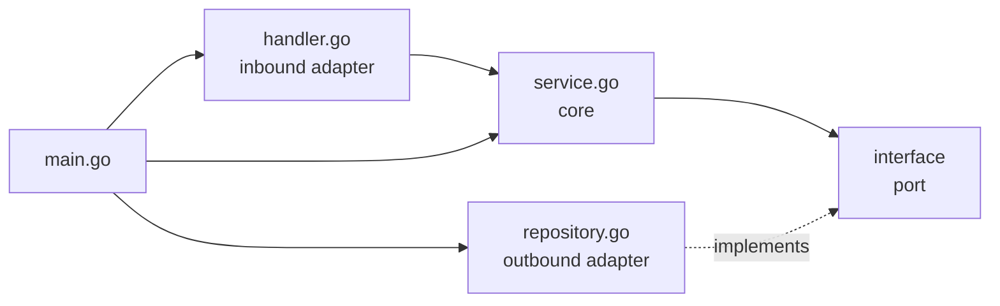
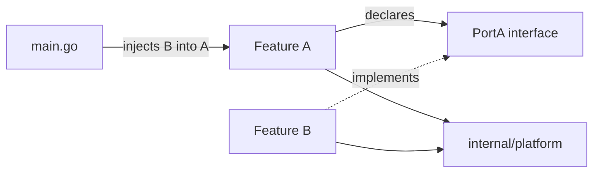

# Sucor Go API: Arsitektur dan Aturan Tim

Status: work in progress. Service ini adalah rewrite dari API Laravel yang sudah ada.

Tujuan dokumen ini: menjelaskan cara menambah module, cara wiring, dan batasan yang tidak boleh dilanggar. Dokumen ini berisi aturan yang berlaku jangka panjang, bukan daftar endpoint yang ada saat ini.

## 1. Konteks

- API Laravel adalah referensi produk. Behavior baru harus sama dengan Laravel 1:1, kecuali ada deviation yang disetujui.
- Saat ini database migration dimiliki dan dijalankan oleh Laravel. Repository ini tidak membuat atau menjalankan migration.
- PostgreSQL schema adalah external contract yang dikelola Laravel. Jangan mengubah schema dari Go.
- Rewrite belum selesai. Komentar TODO di code menandai flow yang masih harus di-port.

## 2. Architecture style

Codebase ini memakai **hexagonal architecture**, atau **ports and adapters**. Konsepnya sama dengan onion architecture: business rule ada di tengah, dan semua hal eksternal adalah adapter di sekelilingnya.

| Konsep | Di codebase ini |
| --- | --- |
| Core / use case | `service.go` dan domain type di `domain.go` |
| Port | Interface yang dideklarasikan oleh consumer, biasanya di `domain.go` |
| Inbound adapter | `handler.go`: HTTP request masuk, response keluar |
| Outbound adapter | `repository.go`: akses database |
| Composition root | `cmd/api/main.go`: membuat adapter dan meng-inject port |

Dependency direction:



Implikasi dari pendekatan ini:

- Service bergantung pada interface, bukan pada repository konkret, HTTP type, atau database.
- Repository mengimplementasikan interface yang dideklarasikan oleh module tempat service berada.
- Handler menerjemahkan HTTP menjadi service call. Tidak ada business rule di handler.
- `main.go` adalah satu-satunya tempat yang tahu semua concrete type.
- Core bisa di-test dengan stub karena tidak punya dependency ke infrastructure.

Project ini sengaja memakai **consumer-declared port**, bukan satu package `ports` di tengah. Module yang membutuhkan capability mendeklarasikan interface paling kecil yang dia butuhkan. Ini menjaga module tetap independen dan menghindari shared package yang di-import semua module.

## 3. Struktur module

Module adalah satu feature folder di dalam `internal/`. Satu folder adalah satu Go package.

Struktur standar untuk module yang punya business rule dan persistence:

```text
internal/event/
  domain.go        entity, request/input struct, port
  repository.go    SQL dan row mapping; outbound adapter
  service.go       business rule; use case
  handler.go       HTTP binding, validation, response; inbound adapter
  errors.go        sentinel error dan MapError
  route.go         RegisterRoutes
  service_test.go
  repository_test.go
  route_test.go
```

| File | Tanggung jawab | Tidak boleh berisi |
| --- | --- | --- |
| `domain.go` | Domain struct, repository interface, consumer-declared port, input/params struct | SQL, HTTP, business flow |
| `repository.go` | Query, scanning, transaction, DB error wrapping | Business rule, HTTP, logging |
| `service.go` | Business rule, permission check, text cleaning, use-case orchestration | SQL, HTTP, `echo` |
| `handler.go` | Bind, validate, baca identity, panggil service, tulis response | Business rule, SQL |
| `errors.go` | Sentinel, `HTTPError`, `MapError` | Side effect, logging |
| `route.go` | Registrasi URL, grup public/protected | Business logic |
| `*_test.go` | Service rule, repository mapping, route behavior | External service asli |

Aturan:

1. Jangan membuat subpackage untuk satu feature kecuali feature benar-benar independen. Pisahkan file berdasarkan concern. Contoh di `internal/post`: `comment_*.go` dan `postlike_*.go`.
2. Nama package harus sama dengan nama folder.
3. Feature-specific code tetap di feature. Jangan pindahkan ke `platform` hanya karena "mungkin bisa dipakai ulang".
4. Jangan import type, error, atau service dari module lain. Gunakan port. Lihat bagian 4.

## 4. Batasan antar module (Module Boundaries)

Import yang diperbolehkan:

| Dari | Boleh import |
| --- | --- |
| Feature module | package-nya sendiri, standard library, dan `internal/platform/*` |
| `internal/platform/*` | standard library dan package platform lain |
| `cmd/api` | semua module dan package platform |
| Feature A | tidak boleh import Feature B |

`internal/platform` adalah satu-satunya shared layer. Isinya infrastructure, bukan business rule.

Komunikasi antar module selalu lewat interface:



Contoh dari code saat ini:

- `internal/post` mendeklarasikan `MembershipChecker` dan `UserStatusReader` di `domain.go` miliknya.
- `community.Service` memenuhi `MembershipChecker` secara struktural; repository-nya hanya membaca data membership dan service yang memutuskan policy posting.
- `auth.UserRepository` memenuhi `UserStatusReader` secara struktural.
- `main.go` meng-inject keduanya ke post service. `internal/post` tidak pernah import `internal/community` atau `internal/auth`.

Kalau method set provider tidak cocok dengan port:

1. Buat adapter di `cmd/api` atau package adapter kecil.
2. Buat adapter mengimplementasikan port tersebut.
3. Inject adapter di `main.go`.

Jangan menyelesaikan mismatch dengan import provider dari consumer. Jangan memakai domain struct milik module lain sebagai shortcut. Kalau hanya butuh sebuah value, deklarasikan port kecil yang mengembalikan value tersebut.

Enforcement: code review wajib menolak import antar feature. Kalau nanti menambah linter, konfigurasikan untuk menolak import dari satu feature package ke feature lain; hanya `cmd/api` dan `platform` yang dikecualikan.

## 5. Wiring di main.go

`cmd/api/main.go` adalah composition root. Hanya file ini yang boleh tahu semua concrete implementation.

Urutan wiring:

```text
config -> logger -> database -> repositories -> shared services -> feature services -> routes -> server start
```

Bentuk wiring:

```go
cfg, err := config.LoadConfig()

database, err := db.NewPostgres(db.DBConfig{...})
defer database.Close()

startupCtx, cancel := context.WithTimeout(context.Background(), 15*time.Second)
defer cancel()

profanityRepository := profanity.NewRepository(database)
profanityService, err := profanity.NewService(startupCtx, profanityRepository)

contentCleaner := contentcleaner.New()

postRepository := post.NewPostRepository(database)
commentRepository := post.NewCommentRepository(database)
postLikeRepository := post.NewPostLikeRepository(database)
communityRepository := community.NewCommunityRepository(database)
communityService := community.NewService(communityRepository)
userRepository := auth.NewUserRepository(database)
authService := auth.NewUserService(userRepository)

postService := post.NewService(postRepository, communityService, userRepository, contentCleaner, profanityService)
commentService := post.NewCommentService(postRepository, commentRepository, communityService, userRepository, contentCleaner, profanityService)
postLikeService := post.NewPostLikeService(postRepository, postLikeRepository, communityService, userRepository)

protected := auth.JWTMiddleware(jwtService)

auth.RegisterRoutes(server.Echo(), protected, authService)
post.RegisterRoutes(server.Echo(), protected, postService, commentService, postLikeService)
```

Aturan:

1. Buat dependency sebelum object yang membutuhkannya.
2. Kirim interface ke service. Concrete type tetap di `main.go`.
3. Kirim middleware ke `RegisterRoutes`; jangan import `auth` di file route milik feature.
4. Jangan pakai global database, global service, service locator, atau package-level singleton.
5. Jangan wiring dependency di `init()`.
6. Validasi config wajib saat startup (JWT secret, TTL, koneksi database) dan fail fast.
7. Daftarkan route setelah semua service siap.
8. Side effect startup tetap di `main.go`: config, logger, database, background loader.

## 6. Menambah module baru

Contoh: `internal/event`.

### Step 1: buat package

Buat `internal/event` dengan file dari bagian 3. Mulai dari `domain.go`.

### Step 2: definisikan core dan port

```go
package event

import (
    "context"
    "time"
)

type Event struct {
    ID          int       `json:"id"`
    CommunityID int       `json:"community_id"`
    CreatedAt   time.Time `json:"created_at"`
}

type Repository interface {
    FindEventByID(ctx context.Context, id int) (*Event, error)
    CreateEvent(ctx context.Context, params CreateEventParams) (*Event, error)
}

type MembershipChecker interface {
    IsMember(ctx context.Context, communityID int, userID int) (bool, error)
}
```

Deklarasikan hanya method yang benar-benar dipakai module. Port bukan salinan repository dari module lain.

### Step 3: implementasikan repository adapter

- Gunakan placeholder `$1`.
- `ctx` selalu jadi argumen pertama.
- Wrap DB error dengan sentinel dan `%w`.
- Pasang stack sekali di tempat error dibuat: `logger.WithStack(...)`.
- Kembalikan sentinel milik feature untuk not found, bukan `sql.ErrNoRows`.
- Gunakan transaction kalau satu request menulis ke beberapa table.
- Jangan logging dari repository.

### Step 4: implementasikan service

- Terima port lewat constructor.
- Terapkan business rule dan kembalikan sentinel error.
- Bersihkan setiap string dari user dengan urutan: trim, `Clean`, `Filter`, lalu cek empty dan length.
- Jangan menulis SQL, HTTP status code, atau type dari `echo`.

### Step 5: definisikan error dan mapping

- Satu sentinel untuk satu business rule.
- Satu branch `MapError` untuk setiap sentinel.
- Status code dan message harus sama dengan Laravel.
- Error level field mengembalikan `422` dengan map `errors` yang key-nya JSON field.

### Step 6: implementasikan handler

- Bind dengan `echo.BindBody`; JSON rusak adalah `400`.
- Validate dengan `c.Validate`; failure mengembalikan `422`.
- Pakai tag `notblank` yang sudah ada untuk menolak string berisi spasi saja.
- Kalau menambah validation tag baru, tambahkan case di `platform/http/validator.go`.
- Baca user ID numerik dengan `identity.UserIDInt(c)`; pakai `identity.UserID(c)` hanya kalau butuh subject string mentah.
- Kembalikan semua error service lewat `writeError` milik module.

### Step 7: daftarkan route

```go
func RegisterRoutes(e *echo.Echo, protected echo.MiddlewareFunc, service *Service) {
    h := NewHandler(service)

    e.GET("/events/:eventId", h.GetEvent)

    authorized := e.Group("/events", protected)
    authorized.POST("", h.CreateEvent)
}
```

### Step 8: wiring

```go
eventRepository := event.NewEventRepository(database)
eventService := event.NewService(eventRepository, communityRepository)

event.RegisterRoutes(server.Echo(), protected, eventService)
```

Kalau `communityRepository` tidak memenuhi `event.MembershipChecker`, buat adapter di `main.go` dan inject adapter tersebut. Jangan import `community` dari `event`.

### Step 9: test

- Satu service test untuk setiap business rule.
- Satu repository test untuk setiap scan helper atau mapping yang tidak trivial.
- Satu route test untuk auth dan response envelope.
- Jalankan `go vet ./...`, `go test ./...`, dan `go build ./...`.

## 7. Yang disediakan platform

`internal/platform` ada supaya module tidak menulis infrastructure yang sama berulang kali. Gunakan ini. Jangan membuat logger kedua, response helper kedua, validator kedua, config loader kedua, atau database opener kedua.

| Package | Capability |
| --- | --- |
| `platform/config` | Load environment variable ke `Config` yang typed. Tambahkan variable baru di sini. |
| `platform/db` | Buka PostgreSQL lewat pgx dan atur connection pool. Mengembalikan `*sql.DB`. |
| `platform/logger` | Process logger, request-scoped logger, error helper, one-time stack attachment. |
| `platform/http` | Echo server, middleware stack, response envelope, request validator, central `HTTPErrorHandler`. |
| `platform/identity` | Menyimpan dan membaca user ID hasil authentication di request context. |
| `platform/contentcleaner` | Trim, HTML sanitize, linkify, dan masking email dan phone. |
| `platform/textutil` | Helper link, email, dan phone yang dipakai cleaner. |
| `platform/storage` | Abstraksi object storage (`Store`) dengan driver local disk dan S3. |
| `platform/files` | Validasi upload, pembuatan key, serving (`http.Handler`), dan signing URL. |

`internal/platform/http` punya nama package `http`, jadi import sebagai `platformhttp` supaya tidak menimpa standard library.

`auth`, `community`, dan `profanity` adalah module, bukan platform. Depend lewat port dan inject di `main.go`.

API yang sering dipakai:

```go
platformhttp.OK(c, "OK", data)
platformhttp.Created(c, "Created", data)
platformhttp.Error(c, http.StatusForbidden, "Forbidden")
platformhttp.ValidationError(c, err, "The given data was invalid.")

logger.L()              // di luar request
logger.Ctx(ctx)         // di dalam request; sudah membawa request_id
logger.Err(ctx, err)    // log sekali di decision boundary
logger.WithStack(err)   // sekali, di tempat error dibuat

identity.UserID(c)      // string subject dari JWT
identity.UserIDInt(c)   // subject numerik, kalau sub berupa angka
```

Ke mana code baru harus diletakkan:

| Code | Lokasi |
| --- | --- |
| Infrastructure yang dipakai lebih dari satu module | `internal/platform/<capability>` |
| Business rule untuk satu feature | `service.go` milik feature tersebut |
| SQL untuk satu feature | `repository.go` milik feature tersebut |
| Interface yang dibutuhkan satu feature | `domain.go` milik feature tersebut |
| Adapter antara dua feature | `cmd/api` atau package adapter kecil |

Aturan untuk `platform`:

1. Platform tidak boleh import feature module mana pun.
2. Platform tidak boleh berisi business rule, permission check, atau feature-specific type.
3. Pindahkan code ke platform hanya kalau itu infrastructure dan minimal module kedua membutuhkannya, atau jelas cross-cutting.
4. Jaga public API tetap kecil. Pilih beberapa function yang fokus, bukan package utility yang lebar.
5. Tambahkan test saat menambah capability platform.
6. Jangan membuat dumping ground bernama `common`, `helpers`, atau `utils`. Beri nama package sesuai capability.

Shared service module seperti `profanity` bukan platform. Perlakukan seperti module lain: depend melalui interface dan inject di `main.go`.

## 8. Aturan tim

### WAJIB

1. Ikuti handler -> service -> repository. Jangan skip layer.
2. Jangan masukkan HTTP dan `echo` ke service atau repository.
3. Jangan masukkan SQL ke service atau handler.
4. Semua response lewat `platformhttp`. Jangan panggil `c.JSON` langsung.
5. Bind dan validasi bentuk request di handler. Business rule yang butuh database tetap di service.
6. Deklarasikan port untuk setiap cross-module dependency. Inject implementation di `main.go`.
7. Feature tidak boleh import feature lain. Hanya `platform` yang shared.
8. Kembalikan sentinel untuk setiap business failure dan mapping di `MapError` module tersebut.
9. Pasang stack sekali di origin. Gunakan `%w` di layer atasnya.
10. Logging sekali, di layer yang menentukan outcome. Jangan logging di repository.
11. Kirim `ctx` ke setiap operasi I/O.
12. Bersihkan setiap string dari user sebelum disimpan. Cek empty lagi setelah cleaning.
13. Tegakkan uniqueness dengan database constraint plus `ON CONFLICT` atau retry. Jangan bergantung pada check-then-insert.
14. Gunakan transaction kalau satu request menulis ke beberapa table.
15. Validasi config wajib saat startup dan fail fast.
16. Samakan behavior dengan Laravel dan tambahkan test untuk aturan baru. `go vet ./...` dan `go test ./...` harus lulus.

### SEBAIKNYA

1. Pilih code eksplisit daripada reflection, registry, atau definisi berbasis meta.
2. Constructor mengembalikan concrete type; consumer menerima interface.
3. Gunakan response struct kalau bentuk API berbeda dari domain struct.
4. Simpan numeric limit di satu tempat dan jaga API message tetap sinkron.
5. Tambahkan environment variable baru ke `.env.example` dan README.
6. Update test yang sudah ada, jangan membuat setup test paralel.
7. Jalankan `gofmt` pada file yang diubah.

### JANGAN PERNAH

1. Jangan logging token, password, secret, atau credential mentah.
2. Jangan mengembalikan raw database error ke client.
3. Jangan memakai package-level database handle atau service.
4. Jangan menaruh business logic di handler "untuk sementara".
5. Jangan import module feature lain, bahkan untuk satu type kecil.
6. Jangan menambah migration atau schema change di sini.

## 9. Laravel parity dan schema

Untuk setiap endpoint yang di-port, bandingkan:

1. HTTP method dan route path.
2. Authentication dan authorization rule.
3. Validation rule dan JSON field key yang persis sama.
4. Status code dan error message.
5. Success response shape.
6. Permission rule: membership, moderator/co-moderator, mute.
7. Side effect: notification, mention, mission, referral, counter.
8. Soft-delete behavior dan timestamp.
9. Default ordering, filtering, dan pagination.

Database schema dimiliki Laravel:

1. Jangan menambah migration di sini.
2. Kalau schema kurang column atau index, ajukan ke pemilik Laravel.
3. Baca schema Laravel sebagai source of truth. Jangan menebak nama column atau type.
4. Dokumentasikan deviation yang disetujui di pull request dan di komentar code yang singkat.

## 10. Docker

Jalankan dari root repository. Kedua compose file membaca `.env`.

Development dengan hot reload:

```bash
docker compose -f docker-compose.dev.yml up --build
```

Production-like verification:

```bash
docker compose -f docker-compose.yml up --build
```

Perbedaan:

| File | Behavior |
| --- | --- |
| `docker-compose.dev.yml` | Memakai `Dockerfile.dev`, mount source ke `/app`, dan menjalankan `air`. Perubahan code memicu rebuild. |
| `docker-compose.yml` | Memakai `Dockerfile`, build binary, dan menjalankannya tanpa source mount. Pakai untuk memverifikasi build yang sebenarnya. |

Keduanya expose port `8090`, memakai container name `rabbitmq-example`, dan menulis log ke `./logs`. Gunakan `docker logs -f rabbitmq-example` untuk mengikuti log. Rebuild dengan `--build` setelah mengubah dependency, Dockerfile, atau compose file.

## 11. Testing dan command

```bash
go vet ./...
go test ./...
go test ./internal/post -cover
go build ./...
```

Convention:

- Service test memakai stub manual. Jangan menambah mocking library tanpa kesepakatan.
- Repository test mencakup row mapping dengan fake `rowScanner`; tambahkan integration test kalau query perlu verifikasi SQL asli.
- Route test memeriksa status code dan response envelope.
- Health test memakai fake pinger.
- Tambahkan atau update test di pull request yang sama dengan perubahan aturan.
