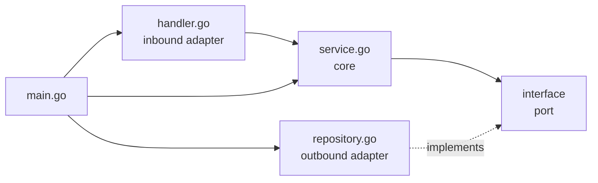
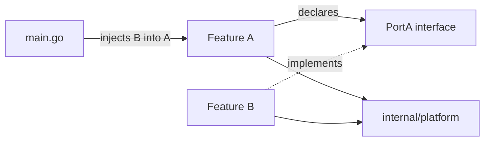

# Sucor Go API: Architecture and Team Guide

Status: work in progress. This service is a rewrite of an existing Laravel API.

Purpose of this document: explain how to add a module, how to wire it, and which boundaries must never be crossed. It describes durable rules, not a list of current endpoints.

## 1. Context

- Laravel API is the product reference. New behavior must match Laravel 1:1 unless a deviation is approved.
- Currently database migrations are owned by Laravel. This repository never creates or runs migrations.
- The PostgreSQL schema is an external contract managed by Laravel. Never change it from Go.
- The rewrite is incomplete. TODO comments in the code mark flows that still need to be ported.

## 2. Architecture style

This codebase follows **hexagonal architecture**, also known as **ports and adapters**. It is the same idea as onion architecture: business rules sit in the center, and everything external is an adapter around them.

| Concept | In this codebase |
| --- | --- |
| Core / use case | `service.go` and the domain types in `domain.go` |
| Port | An interface declared by the consumer, usually in `domain.go` |
| Inbound adapter | `handler.go`: HTTP request in, response out |
| Outbound adapter | `repository.go`: database access |
| Composition root | `cmd/api/main.go`: constructs adapters and injects ports |

Dependency direction:



Rules that follow from this:

- The service depends on interfaces, not on concrete repositories, HTTP types, or the database.
- The repository implements an interface declared by the service's module.
- The handler translates HTTP into a service call. It contains no business rules.
- `main.go` is the only place that knows all concrete types.
- The core is testable with stubs because it has no infrastructure dependency.

This project deliberately uses **consumer-declared ports** instead of one central `ports` package. The module that needs the capability declares the smallest interface it needs. That keeps modules independent and avoids a shared package that every module depends on.

## 3. Module structure

A module is one feature folder under `internal/`. One folder is one Go package.

Canonical layout for a module with business rules and persistence:

```text
internal/event/
  domain.go        entities, request/input structs, ports
  repository.go    SQL and row mapping; outbound adapter
  service.go       business rules; use cases
  handler.go       HTTP binding, validation, response; inbound adapter
  errors.go        sentinel errors and MapError
  route.go         RegisterRoutes
  service_test.go
  repository_test.go
  route_test.go
```

| File | Responsibility | Must not contain |
| --- | --- | --- |
| `domain.go` | Domain structs, repository interface, consumer-declared ports, input/params structs | SQL, HTTP, business flow |
| `repository.go` | Queries, scanning, transactions, DB error wrapping | Business rules, HTTP, logging |
| `service.go` | Business rules, permission checks, text cleaning, use-case orchestration | SQL, HTTP, `echo` |
| `handler.go` | Bind, validate, read identity, call service, write response | Business rules, SQL |
| `errors.go` | Sentinels, `HTTPError`, `MapError` | Side effects, logging |
| `route.go` | URL registration, public/protected groups | Business logic |
| `*_test.go` | Service rules, repository mapping, route behavior | Real external services |

Rules:

1. Do not create subpackages for one feature unless the feature becomes genuinely independent. Split files by concern instead. In `internal/post`, `comment_*.go` and `postlike_*.go` are examples.
2. Keep the package name equal to the folder name.
3. Keep feature-specific code in the feature. Do not move it to `platform` just because it is reusable in theory.
4. Do not import another module's types, errors, or services. Use a port instead. See section 4.

## 4. Module boundaries

Allowed imports:

| From | May import |
| --- | --- |
| A feature module | its own package, the standard library, and `internal/platform/*` |
| `internal/platform/*` | standard library and other platform packages |
| `cmd/api` | every module and platform package |
| Feature A | must not import Feature B |

`internal/platform` is the only shared layer. It contains infrastructure, not business rules.

Cross-module communication always goes through an interface:



Example from the current code:

- `internal/post` declares `MembershipChecker` and `UserStatusReader` in its own `domain.go`.
- `community.Service` satisfies `MembershipChecker` structurally; its repository only reads membership data and the service owns the posting policy.
- `auth.UserRepository` satisfies `UserStatusReader` structurally.
- `main.go` injects both into the post services. `internal/post` never imports `internal/community` or `internal/auth`.

If a provider's method set does not match the port:

1. Write an adapter in `cmd/api` or a small adapter package.
2. Make the adapter implement the port.
3. Inject the adapter in `main.go`.

Do not solve a mismatch by importing the provider from the consumer. Do not share another module's domain struct as a shortcut. If only a value is needed, define a small port that returns that value.

Enforcement: code review must reject feature-to-feature imports. If we add a linter, configure it to deny imports from one feature package to another; only `cmd/api` and `platform` are exceptions.

## 5. Wiring in main.go

`cmd/api/main.go` is the composition root. It is the only file allowed to know every concrete implementation.

Wiring order:

```text
config -> logger -> database -> repositories -> shared services -> feature services -> routes -> server start
```

Shape of the wiring:

```go
cfg, err := config.LoadConfig()

database, err := db.NewPostgres(db.DBConfig{...})
defer database.Close()

startupCtx, cancel := context.WithTimeout(context.Background(), 15*time.Second)
defer cancel()

profanityRepository := profanity.NewRepository(database)
profanityService, err := profanity.NewService(startupCtx, profanityRepository)

contentCleaner := contentcleaner.New()

postRepository := post.NewPostRepository(database)
commentRepository := post.NewCommentRepository(database)
postLikeRepository := post.NewPostLikeRepository(database)
communityRepository := community.NewCommunityRepository(database)
communityService := community.NewService(communityRepository)
userRepository := auth.NewUserRepository(database)
authService := auth.NewUserService(userRepository)

postService := post.NewService(postRepository, communityService, userRepository, contentCleaner, profanityService)
commentService := post.NewCommentService(postRepository, commentRepository, communityService, userRepository, contentCleaner, profanityService)
postLikeService := post.NewPostLikeService(postRepository, postLikeRepository, communityService, userRepository)

protected := auth.JWTMiddleware(jwtService)

auth.RegisterRoutes(server.Echo(), protected, authService)
post.RegisterRoutes(server.Echo(), protected, postService, commentService, postLikeService)
```

Rules:

1. Construct dependencies before the objects that need them.
2. Pass interfaces to services. Concrete types stay in `main.go`.
3. Pass middleware into `RegisterRoutes`; do not import `auth` inside a feature's route file.
4. Do not use a global database, global service, service locator, or package-level singleton.
5. Do not wire dependencies in `init()`.
6. Validate required startup configuration in `main.go` (JWT secret, TTL, database connection) and fail fast.
7. Register routes after all services exist.
8. Keep startup side effects in `main.go`: config, logger, database, background loaders.

## 6. Adding a new module

Example: `internal/event`.

### Step 1: create the package

Create `internal/event` with the files from section 3. Start with `domain.go`.

### Step 2: define the core and the ports

```go
package event

import (
    "context"
    "time"
)

type Event struct {
    ID          int       `json:"id"`
    CommunityID int       `json:"community_id"`
    CreatedAt   time.Time `json:"created_at"`
}

type Repository interface {
    FindEventByID(ctx context.Context, id int) (*Event, error)
    CreateEvent(ctx context.Context, params CreateEventParams) (*Event, error)
}

type MembershipChecker interface {
    IsMember(ctx context.Context, communityID int, userID int) (bool, error)
}
```

Declare only the methods the module actually uses. A port is not a copy of another module's repository.

### Step 3: implement the repository adapter

- Use `$1` placeholders.
- Put `ctx` first in every method.
- Wrap DB errors with a sentinel and `%w`.
- Attach the stack once where the error is created: `logger.WithStack(...)`.
- Return a feature sentinel for not found, not `sql.ErrNoRows`.
- Use a transaction when one request writes to multiple tables.
- Never log from the repository.

### Step 4: implement the service

- Accept ports through the constructor.
- Apply business rules and return sentinel errors.
- Clean every user-generated string in this order: trim, `Clean`, `Filter`, then check empty and length.
- Never write SQL, HTTP status codes, or `echo` types.

### Step 5: define errors and mapping

- One sentinel per business rule.
- One `MapError` branch per sentinel.
- Keep status codes and messages aligned with Laravel.
- Field-level errors return `422` with an `errors` map keyed by the JSON field.

### Step 6: implement the handler

- Bind with `echo.BindBody`; malformed JSON is `400`.
- Validate with `c.Validate`; failures return `422`.
- Use the existing `notblank` tag for whitespace-only rejection.
- If you add a new validation tag, add a case to `platform/http/validator.go`.
- Read the numeric user ID with `identity.UserIDInt(c)`; use `identity.UserID(c)` only when the raw string subject is needed.
- Return all service errors through the module's `writeError`.

### Step 7: register routes

```go
func RegisterRoutes(e *echo.Echo, protected echo.MiddlewareFunc, service *Service) {
    h := NewHandler(service)

    e.GET("/events/:eventId", h.GetEvent)

    authorized := e.Group("/events", protected)
    authorized.POST("", h.CreateEvent)
}
```

### Step 8: wire it

```go
eventRepository := event.NewEventRepository(database)
eventService := event.NewService(eventRepository, communityRepository)

event.RegisterRoutes(server.Echo(), protected, eventService)
```

If `communityRepository` does not satisfy `event.MembershipChecker`, create an adapter in `main.go` and inject that adapter. Do not import `community` from `event`.

### Step 9: test

- One service test for every business rule.
- One repository test for every scan helper or non-trivial mapping.
- One route test for auth and the response envelope.
- Run `go vet ./...`, `go test ./...`, and `go build ./...`.

## 7. Platform capabilities

`internal/platform` exists so modules do not rewrite the same infrastructure. Reuse it. Do not create a second logger, response helper, validator, config loader, or database opener.

| Package | Capability |
| --- | --- |
| `platform/config` | Loads environment variables into a typed `Config`. Add new variables here. |
| `platform/db` | Opens PostgreSQL through pgx and configures the connection pool. Returns `*sql.DB`. |
| `platform/logger` | Process logger, request-scoped logger, error helper, one-time stack attachment. |
| `platform/http` | Echo server, middleware stack, response envelope, request validator, central `HTTPErrorHandler`. |
| `platform/identity` | Stores and reads the authenticated user ID in the request context. |
| `platform/contentcleaner` | Trim, HTML sanitize, linkify, and mask emails and phones. |
| `platform/textutil` | Link, email, and phone helpers used by the cleaner. |
| `platform/storage` | Object storage abstraction (`Store`) with local-disk and S3 drivers. |
| `platform/files` | Upload validation, key generation, serving (`http.Handler`), and URL signing. |

`internal/platform/http` has the package name `http`, so import it as `platformhttp` to avoid shadowing the standard library.

`auth`, `community`, and `profanity` are modules, not platform. Depend on them through ports and inject them in `main.go`.

Common APIs:

```go
platformhttp.OK(c, "OK", data)
platformhttp.Created(c, "Created", data)
platformhttp.Error(c, http.StatusForbidden, "Forbidden")
platformhttp.ValidationError(c, err, "The given data was invalid.")

logger.L()              // outside a request
logger.Ctx(ctx)         // inside a request; includes request_id
logger.Err(ctx, err)    // log once at the decision boundary
logger.WithStack(err)   // once, where the error was born

identity.UserID(c)      // string subject from the JWT
identity.UserIDInt(c)   // numeric subject, when sub is numeric
```

How to decide where new shared code goes:

| Code | Location |
| --- | --- |
| Infrastructure used by more than one module | `internal/platform/<capability>` |
| Business rule for one feature | that feature's `service.go` |
| SQL for one feature | that feature's `repository.go` |
| Interface needed by one feature | that feature's `domain.go` |
| Adapter between two features | `cmd/api` or a small adapter package |

Rules for `platform`:

1. Platform must not import any feature module.
2. Platform must not contain business rules, permission checks, or feature-specific types.
3. Promote code to platform only when it is infrastructure and at least a second module needs it, or when it is clearly cross-cutting.
4. Keep the public API small. Prefer a few focused functions over a broad utility package.
5. Add tests when adding a platform capability.
6. Do not create a `common`, `helpers`, or `utils` dumping ground. Name the package after the capability.

Shared service modules such as `profanity` are not platform. Treat them like any other module: depend on them through an interface and inject them in `main.go`.

## 8. Team rules

### MUST

1. Follow handler -> service -> repository. No layer skipping.
2. Keep HTTP and `echo` out of services and repositories.
3. Keep SQL out of services and handlers.
4. Route every response through `platformhttp`. Do not call `c.JSON` directly.
5. Bind and shape-validate requests in the handler. Keep database-dependent rules in the service.
6. Declare a port for every cross-module dependency. Inject the implementation in `main.go`.
7. A feature must not import another feature. Only `platform` is shared.
8. Return a sentinel for every business failure and map it in that module's `MapError`.
9. Attach a stack once at the origin. Use `%w` above it.
10. Log once, at the layer that decides the outcome. Never log in repositories.
11. Pass `ctx` through every I/O call.
12. Clean every user string before storing it. Re-check emptiness after cleaning.
13. Enforce uniqueness with a database constraint plus `ON CONFLICT` or retry. Never rely on check-then-insert.
14. Use a transaction when one request writes to multiple tables.
15. Validate required configuration at startup and fail fast.
16. Match Laravel behavior and add tests for new rules. `go vet ./...` and `go test ./...` must pass.

### SHOULD

1. Prefer explicit code over reflection, registries, or meta-driven definitions.
2. Keep constructors returning concrete types; keep consumers accepting interfaces.
3. Use response structs when the API shape differs from the domain struct.
4. Keep numeric limits in one place and keep API messages in sync.
5. Add new environment variables to `.env.example` and the README.
6. Update existing tests instead of creating a parallel test setup.
7. Run `gofmt` on files you touch.

### NEVER

1. Never log tokens, passwords, secrets, or raw credentials.
2. Never return a raw database error to the client.
3. Never use a package-level database handle or service.
4. Never put business logic in a handler "for now".
5. Never import another feature module, even for a small type.
6. Never add a migration or schema change here.

## 9. Laravel parity and schema

For every ported endpoint, compare:

1. HTTP method and route path.
2. Authentication and authorization rules.
3. Validation rules and exact JSON field keys.
4. Status codes and error messages.
5. Success response shape.
6. Permission rules: membership, moderator/co-moderator, mute.
7. Side effects: notifications, mentions, missions, referrals, counters.
8. Soft-delete behavior and timestamps.
9. Default ordering, filtering, and pagination.

The database schema is owned by Laravel:

1. Do not add migrations here.
2. If the schema is missing a column or index, raise it with the Laravel owners.
3. Read the Laravel schema as the source of truth. Do not guess column names or types.
4. Document approved deviations in the pull request and in a short code comment.

## 10. Docker

Run from the repository root. Both compose files read `.env`.

Development with hot reload:

```bash
docker compose -f docker-compose.dev.yml up --build
```

Production-like verification:

```bash
docker compose -f docker-compose.yml up --build
```

Differences:

| File | Behavior |
| --- | --- |
| `docker-compose.dev.yml` | Uses `Dockerfile.dev`, mounts the source into `/app`, and runs `air`. Code changes trigger a rebuild. |
| `docker-compose.yml` | Uses `Dockerfile`, builds a binary, and runs it without the source mount. Use it to verify the real build. |

Both expose port `8090`, use container name `rabbitmq-example`, and write logs to `./logs`. Use `docker logs -f rabbitmq-example` to follow logs. Rebuild with `--build` after changing dependencies, Dockerfiles, or compose files.

## 11. Testing and commands

```bash
go vet ./...
go test ./...
go test ./internal/post -cover
go build ./...
```

Conventions:

- Service tests use hand-written stubs. Do not add a mocking library without agreement.
- Repository tests cover row mapping with a fake `rowScanner`; add an integration test when a query needs real SQL verification.
- Route tests assert status codes and the response envelope.
- Health tests use a fake pinger.
- Add or update tests in the same pull request as the rule change.

